> **Built on [page-mascot](https://github.com/nilbuild/page-mascot) by Kamran Ahmed (MIT).** The image pipeline, the prompt text, the runtime component and all fifty-three gallery characters are his work, ported or used directly. See [THIRD_PARTY_NOTICES.md](THIRD_PARTY_NOTICES.md) and [public/mascots/CREDITS.txt](public/mascots/CREDITS.txt). Keep those notices with any copy.
>
> **Looking for the one without the borrowed parts?** [**Mascotry**](https://github.com/LihanCanCode/Mascotry) is a clean-room rebuild of the same idea: every character is drawn by code rather than by an image model, so it needs no prompts, no chat and no upload, and it carries no third-party work. This repository is kept for the route Mascotry does not have — turning a real photograph into a mascot through a chat model.

<div align="center">

# Mascot Maker

[](https://github.com/LihanCanCode/mascot-maker/stargazers)
[](https://lihancancode.github.io/mascot-maker/)
[](LICENSE)

**A photo and any free chat model, into a mascot that watches your reader.**

You describe a character and pick a style. The app writes two prompts. You run them in your own
Gemini or ChatGPT with your photo attached, and bring the two pictures back.

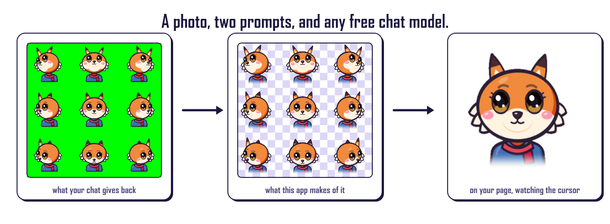

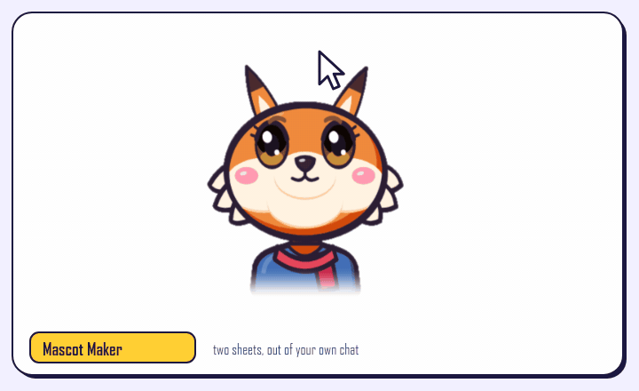

Free. No account, no API key. Your two images are processed on your device and never uploaded.

</div>

---

## What it is

Image models will happily draw you a nine-pose sprite sheet. What they will not do is give you one
that *works*: the background is never really transparent, the nine drawings are never quite the same
size, the body shifts between the two sheets, and you cannot tell which of your two prompts to run
again.

This app is the part in between. It chroma-keys the flat background, finds the 3×3 grid and cuts it,
measures every cell, rescales and re-anchors each one so the body does not jump as the head turns,
composes two clean sheets — and then **checks its own work and tells you, in plain English, which
prompt to redo**.

There is no service behind it and no API key. The generation happens in the free chat you already
have, because Gemini's free API tier has no image output and this project does not rent GPUs. Your
photo goes to that provider under their terms, and never to us.

A gallery of ready-made characters is included for people who do not want to generate anything; it
is [Kamran Ahmed's artwork](public/mascots/CREDITS.txt), not this project's.

Finished mascots can be kept: **Save to my gallery** on the export step puts one in **My gallery**
(`#saved`), an IndexedDB store in your own browser. Still no server and no account, which also means
it lives in that one browser on that one device and goes away with your site data — so the gallery
says so plainly, shows the space it uses, and can write the whole thing to a single JSON file you
can keep and import back anywhere.

> **About the pictures in this README.** Every sheet shown below was drawn by this repository's own
> `src/studio` code and rendered onto the flat green the prompts ask for, so that the documentation
> contains no photograph of a real person and no borrowed artwork. They stand in for what a chat
> model hands back — they were not produced by one. Everything downstream of them is the real
> pipeline, run unmodified. Regenerate the lot with `pnpm run images && pnpm run shots && pnpm run gif`.

## How it works

### 1. Describe it, and pick a style

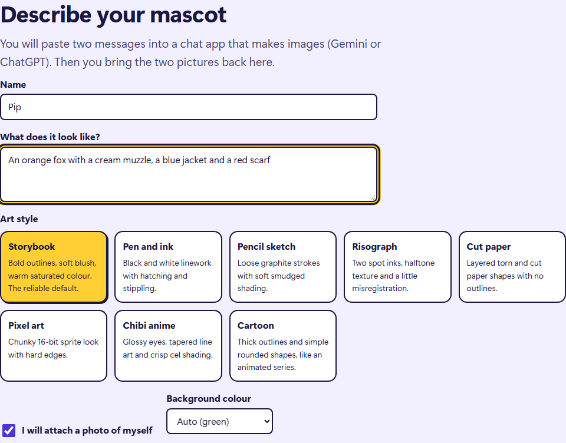

Eight styles, from storybook to pixel art to pen-and-ink. Tick the box if you are going to attach a
photo of yourself, and the first prompt becomes the one that redraws a person as a character.

### 2. It writes the two prompts

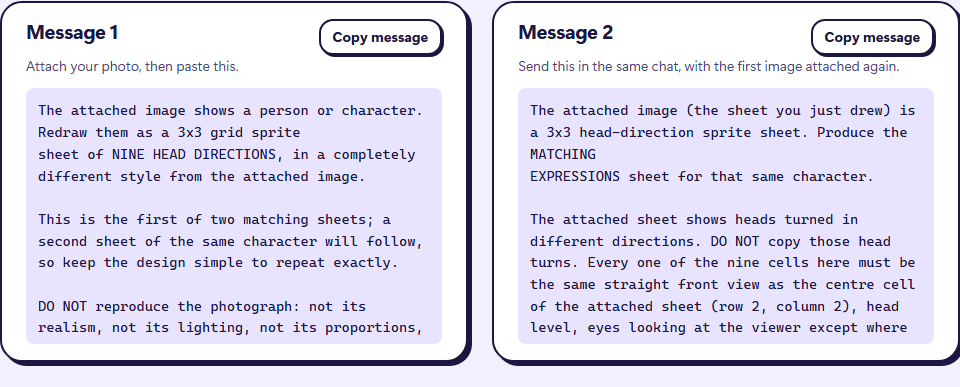

Message 1 asks for the nine head directions. Message 2, sent in the same chat with the first image
attached, asks for the nine expressions of that same character. Copy them, run them in Gemini or
ChatGPT, download both pictures at full size.

### 3. Bring both images back

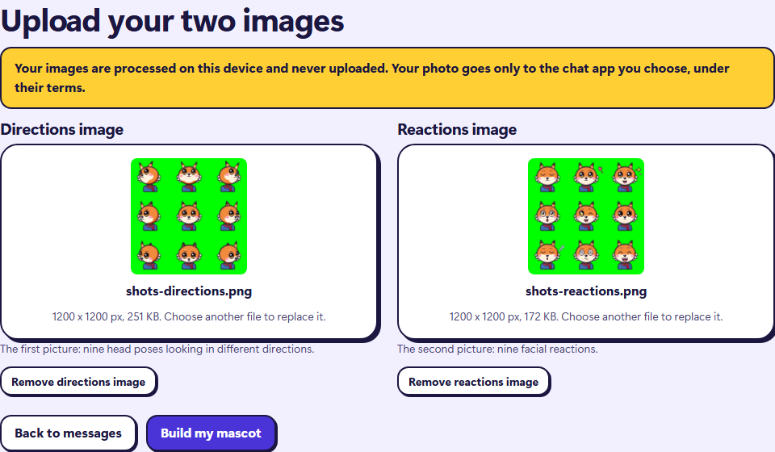

Drop the two files in. Nothing is uploaded: the work happens in a Web Worker on your own machine,
and usually takes five to fifteen seconds.

### 4. Export

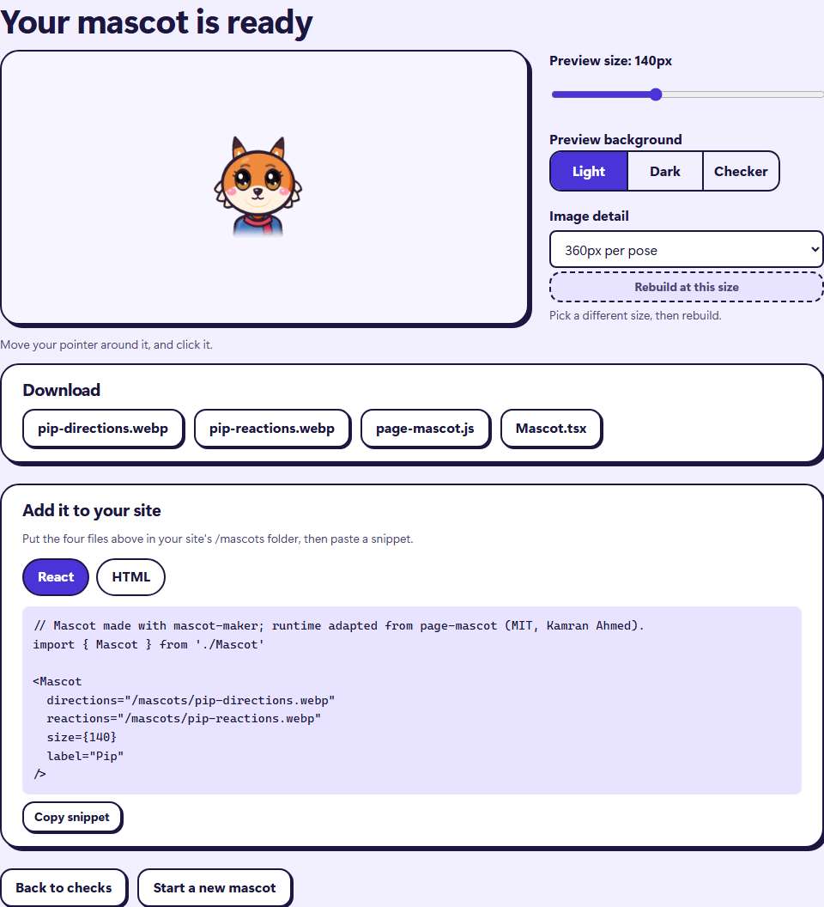

Two `.webp` sheets, the runtime component, the framework-free element, and the snippet to paste.

## What the checker catches

This is the part nothing else does. Once the two sheets are built, they are measured against each
other and the result is a verdict rather than a shrug.

When the two sheets agree, it says so and gets out of the way:

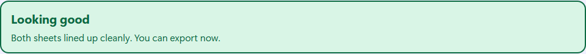

When they do not, it is specific.

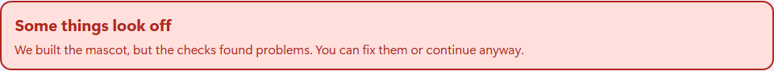

Here the reactions sheet came back as a different character — the single most common mistake, made
by running Message 2 in a fresh chat instead of the one holding your directions image. The checker
does not just fail; it says what is wrong, by how much, and which message to run again.

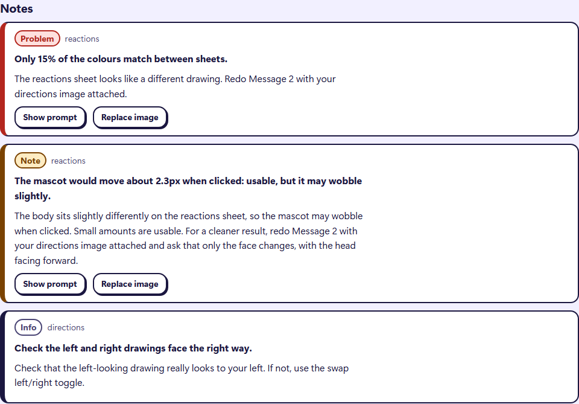

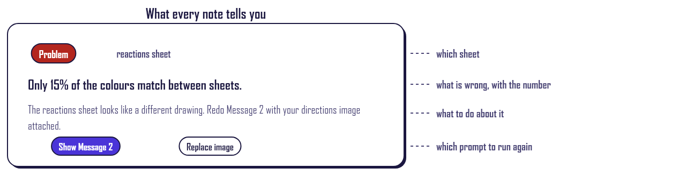

There are thirty-odd checks. They cover the background (a grey-and-white checkerboard means the
model drew transparency instead of having it), the grid, each cell's size and coverage, parts of the
character that are too close to the key colour, the shoulder width across all nine drawings, how far
the body would move when the mascot is clicked, and whether the two sheets even look like the same
drawing. Each one carries its own plain-English fix, and nothing blocks export unless the result
would genuinely be unusable.

## What it does to your two images

Every cell is measured, then rescaled and re-anchored on its shoulders so that the nine drawings
share one body. Stack all nine on top of each other and the difference is the whole point:

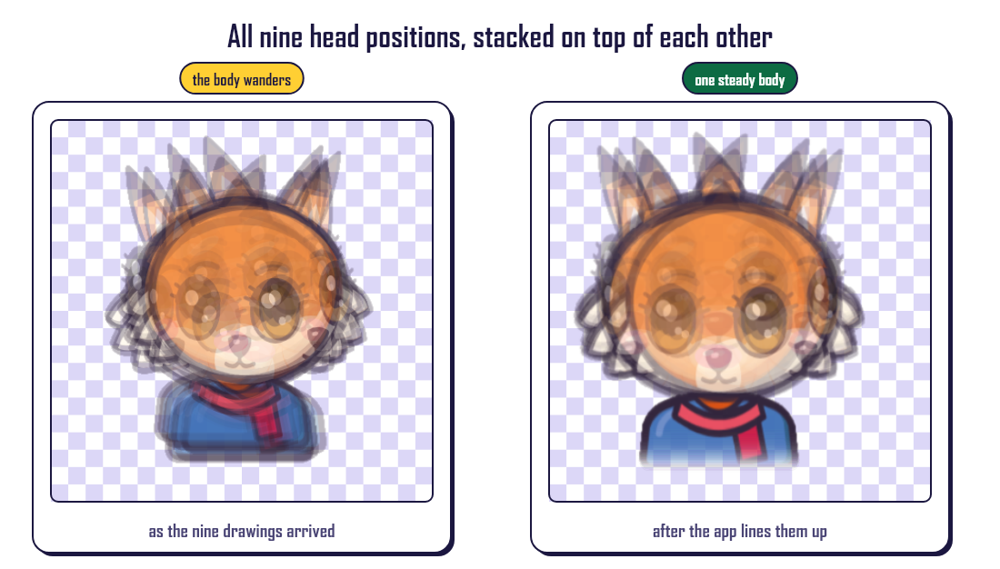

*(The left panel is the demonstration sheet with a deliberate per-cell wobble applied to the input,
standing in for the drift a chat model really produces — a code-drawn sheet has none of its own.
The right panel is what the aligner returns.)*

The output is two 3×3 sheets. The first holds nine head directions, chosen at runtime from where
your cursor is:

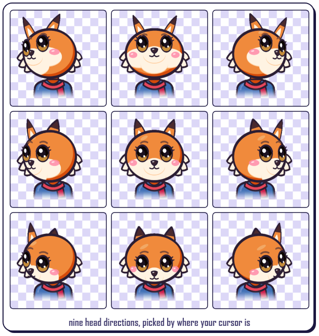

The second holds nine expressions, shown when someone clicks it:

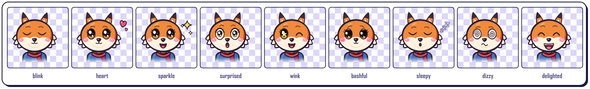

The component measures where the pointer sits relative to the mascot and shifts the background
position to the matching cell. Two image loads, no layout work per frame.

## Put it on your page

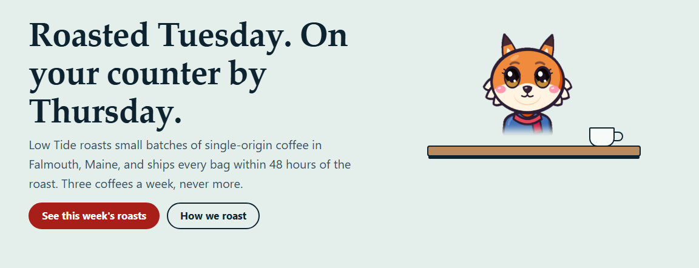

```tsx
import { Mascot } from './Mascot'

<Mascot
  directions="/mascots/pip-directions.webp"
  reactions="/mascots/pip-reactions.webp"
  size={140}
  label="Pip"
/>
```

Not using React? The same thing ships as a custom element, with no framework at all:

```html
<script type="module" src="/mascots/page-mascot.js"></script>
<page-mascot
  directions="/mascots/pip-directions.webp"
  reactions="/mascots/pip-reactions.webp"
  size="140"
  label="Pip"
></page-mascot>
```

Both respect `prefers-reduced-motion`, stay quiet on touch devices where there is no cursor to
follow, and work under a strict Content Security Policy.

## Run it

```bash
pnpm install
pnpm dev          # http://localhost:5173
pnpm test         # unit and integration tests (Vitest)
pnpm test:cov     # with coverage (80% thresholds)
pnpm typecheck
pnpm build        # static site in dist/
pnpm e2e          # browser tests
```

`pnpm dev` also serves a demo page at `/demo.html`: a made-up coffee roaster's website with a mascot
on its shelf, built from the same files this repo ships.

Deploy `dist/` to any static host. `public/_headers` carries a strict CSP for hosts that support it.

### The launch media

Every picture in this README, and the films and stills under `media/`, are generated by committed
scripts. None of them is screen-captured by hand, and all of them run the real pipeline.

```bash
pnpm run images   # the diagrams in docs/images
pnpm run shots    # the screenshots in docs/images
pnpm run gif      # docs/images/demo.gif
pnpm run stills   # six 1600px stills in media/stills
pnpm run reel     # a 1080x1920 reel and a 1280x720 cut in media/
```

`media/` is gitignored: the films are large and entirely reproducible from the above.

## Layout

| Path | What |
|---|---|
| `src/core` | Pure image pipeline on RGBA buffers: keyer, slicer, measure, aligner, composer, validator, pipeline |
| `src/prompts` | Prompt builders, style presets, key-colour picker, chat how-to |
| `src/mascot`, `src/embed` | The runtime component and the embed snippets (shipped raw to users) |
| `src/studio` | Code-drawn characters, used by the tests and the launch media as stand-in input |
| `src/adapters`, `src/worker` | Browser decode/encode, Web Worker |
| `src/ui` | React steps, components, state machine |
| `scripts/` | The launch-media generators described above |
| `docs/PLAN.md` | Full design and module contracts |

## Known limits

- **You have to do the chat step by hand.** There is no API key and no generation here. Free plans
  cap how many images you can make, so check before you start.
- **The second sheet is the one that goes wrong.** Models like to keep turning the head on the
  expressions sheet, or to drift into a different character. Both are caught, and both mean running
  Message 2 again in a *new* chat with your directions image attached — retrying in the same chat
  makes it worse, because the model averages its earlier attempts.
- **Wide features get cut off.** Wings, broad hats and long flowing hair do not survive a square
  cell. The description box warns you about these before you generate anything.
- **A character coloured close to the key will look see-through.** Switch the background colour in
  setup — green, magenta and blue are all offered — and redo both messages.
- **Nothing here can check that the left-looking drawing looks to your left.** Models mirror the
  sheet about half the time. There is a swap toggle and an explicit prompt to go and look.
- **The gallery is not this project's work.** The fifty-three characters in `public/mascots` are
  Kamran Ahmed's, under MIT, credited in `public/mascots/CREDITS.txt`.

## If you like it

A [star on GitHub](https://github.com/LihanCanCode/mascot-maker) is how I find out anyone used this. That is the whole ask — there is nothing to sign up for and nothing to pay.

## Credits and licence

MIT, © 2026 LihanCanCode.

The pipeline thresholds, the prompt text, the runtime component and the gallery artwork are ported
or used from [page-mascot](https://github.com/nilbuild/page-mascot) by Kamran Ahmed, MIT. See
[THIRD_PARTY_NOTICES.md](THIRD_PARTY_NOTICES.md). The fox sheets in `src/test/assets` are from that
project and are used only as test fixtures.

The characters in this README and in the launch media are drawn by `src/studio`, which is original
work written for this repository.
